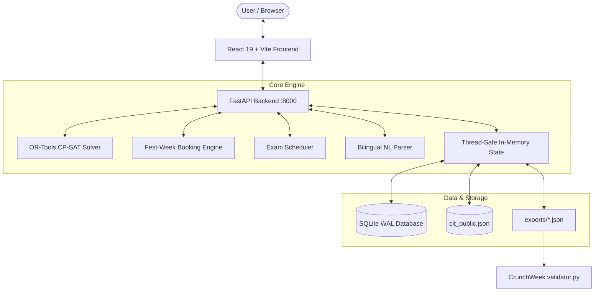
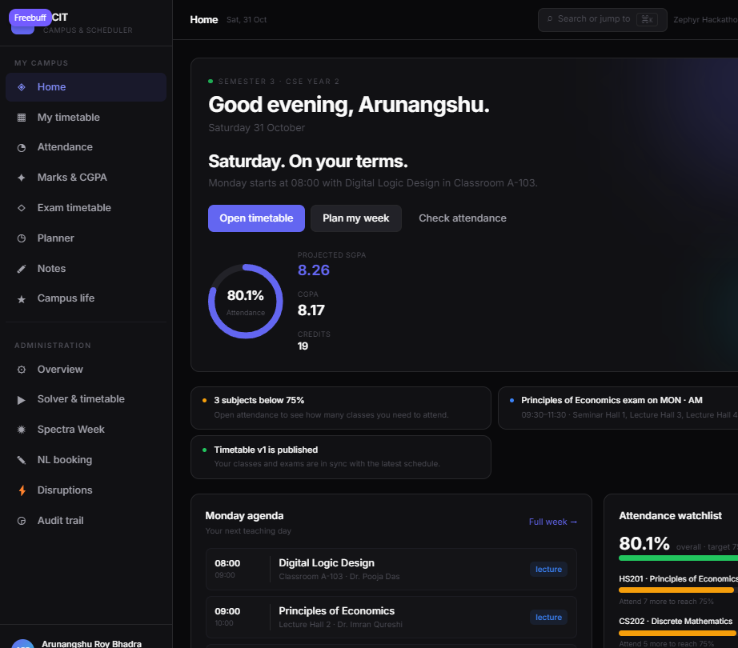
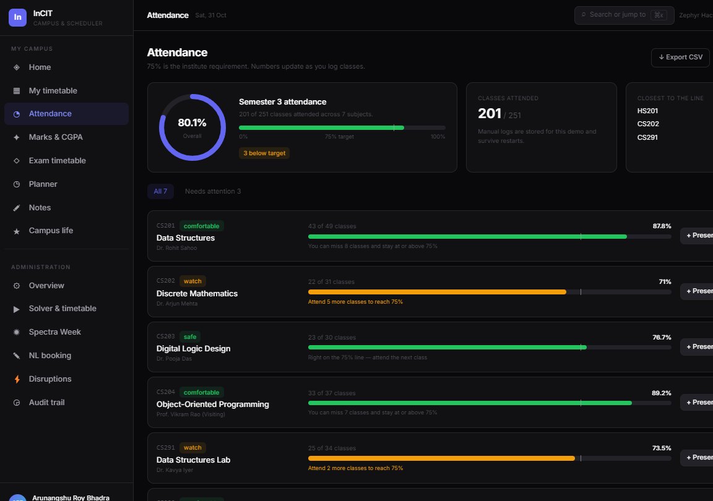
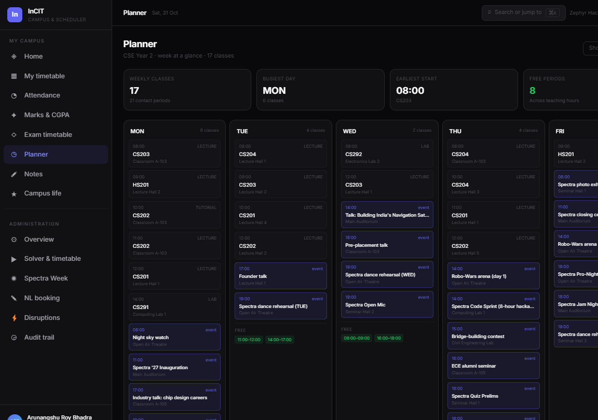

# InCIT — Institutional Timetable & Resource Scheduling Engine

[](https://fastapi.tiangolo.com)
[](https://developers.google.com/optimization)
[](https://react.dev)
[](https://www.typescriptlang.org)
[](https://vitejs.dev)
[](https://tailwindcss.com)
[](file:///exports/schedule.json)

**InCIT** is an institutional resource scheduling platform built for the **Zephyr Hackathon / CrunchWeek**. It combines Google's OR-Tools CP-SAT constraint programming solver, a prioritized booking engine for campus festivals, an exam room allocator, and a dual-language (English + Hindi) natural language booking parser into an interactive, real-time web dashboard.

---

## 🌟 Key Capabilities & Highlights

1. **Deterministic Constraint Satisfaction (CP-SAT)**:
   - Implements **all Hard Constraints H1 through H14** (faculty conflict-free, room capacity, equipment/type match, student group non-overlap, basket slot synchronization, daily faculty hour caps, lunch preservation, lab start restrictions).
   - Solves the complete 189-session institutional dataset in under **15 seconds** with **0 Hard Violations**.
   - Minimises the solver-side soft objectives (**S1** faculty avoid-preferences, **S5** room utilisation, **S6** P9 usage); the official validator additionally scores S2–S4.

2. **Spectra Fest-Week Booking Engine**:
   - Manages competing club and departmental room requests using official priority order (`academics > institute_event > club_major > club_event > personal`).
   - Implements strict role-category caps (Student, Faculty, Dean) and automated alternative venue recommendation.

3. **Semester Exam Scheduler**:
   - Automatically allocates 41 semester exams into half-capacity rooms to ensure social distancing and strict non-cheating conditions.
   - Avoids group clashes across AM/PM exam slots; faculty invigilator rosters are a planned extension.

4. **Dual-Language Natural Language Booking (English & Hindi)**:
   - Regex-powered bilingual NLP engine extracting attendee counts, time windows, day preferences, accessibility needs, and equipment requests.
   - Understands native Hindi input (e.g., *"कल दोपहर 2 बजे 50 लोगों के लिए सेमिनार हॉल चाहिए"*).

5. **Dynamic Disruption Simulation & Re-Solving**:
   - Simulates emergency room closures (e.g., maintenance), sudden faculty leave, and urgent session insertions.
   - Instant re-solve capability with audit logging and stability metrics.

6. **Interactive Dark-Mode Web Dashboard**:
   - Modern React 19 + TypeScript + Vite frontend.
   - Interactive Timetable Grid (Day × Period matrix) filterable by Faculty, Room, or Student Group.
   - Fest-week approvals view, live bilingual NL booking sandbox, disruption tester, and one-click JSON export.

7. **Student & Campus Portal (Campus Web layer)**:
   - Six demo student profiles mapped to the dataset's real groups, with a profile switcher and ⌘K campus search.
   - Dashboard with next class, attendance ring, projected SGPA/CGPA, exam alerts, fest events and mess menu.
   - Attendance tracking with 75% target maths, present/absent logging, a what-if simulator and CSV export.
   - Marks/CGPA breakdown, exam timetable with half-capacity seat plans, weekly planner with free study windows.
   - Course notes (create/edit/pin/delete, persisted server-side), plus events, clubs and mess tabs.
   - Every student view reads the published solver output; demo-only attendance and marks are clearly labelled.

---

## 🏆 Official Validator Benchmark Results

Both output schedules were tested directly against the official CrunchWeek StarterPack `validator.py`:

### Baseline Schedule (`exports/schedule.json`)
```
Dataset: cit-public-v1   Schedule says: cit-public-v1   Team: InCIT
Hard violations: 0  {}
Soft penalty: 203  {'S1': 0, 'S2': 80, 'S3': 42, 'S4': 81, 'S5': 0, 'S6': 0}
Bookings: score 67.0 | approved 22, alternatives 1, rejected 2, session overrides 0, priority inversions 0
Exam soft penalty: 0
```

### Disrupted Schedule (`exports/schedule_after.json`)
```
Dataset: cit-public-v1   Schedule says: cit-public-v1   Team: InCIT
Hard violations: 0  {}
Soft penalty: 230  {'S1': 0, 'S2': 116, 'S3': 15, 'S4': 99, 'S5': 0, 'S6': 0}
Bookings: score 63.0 | approved 20, alternatives 3, rejected 2, session overrides 0, priority inversions 0
Exam soft penalty: 0
Stability: 185 sessions moved (179 changed time, 6 room only)
```

---

## 🏗️ System Architecture



---

## 📁 Repository Structure

```
InCIT/
├── app/                        # FastAPI Backend Application
│   ├── main.py                 # REST API endpoints & route definitions (40+ endpoints)
│   ├── portal.py               # Student portal: profiles, attendance, marks, planner, notes, search
│   ├── solver.py               # Google OR-Tools CP-SAT solver implementation
│   ├── booking_engine.py       # Fest-week / Spectra priority booking system
│   ├── exam_scheduler.py       # Exam room & slot scheduler (half capacity)
│   ├── nl_parser.py            # Bilingual English/Hindi natural language parser
│   ├── models.py               # 19 SQLAlchemy 2.0 ORM models
│   ├── db.py                   # SQLite connection with WAL mode & foreign keys
│   ├── validator.py            # Deterministic interval validation engine
│   ├── validator_bridge.py     # Adapter to official CrunchWeek validator
│   ├── state.py                # In-memory runtime state, versioning, audit trail
│   ├── schemas.py              # Pydantic v2 schemas for all inputs/outputs
│   └── config.py               # Global settings, paths, CORS configurations
├── frontend/                   # React 19 Frontend Dashboard
│   ├── src/
│   │   ├── components/         # Layout and reusable UI components
│   │   ├── pages/
│   │   │   ├── StudentHome.tsx # Student dashboard: next class, attendance, SGPA, exams, events
│   │   │   ├── MyTimetable.tsx # Read-only student week grid with class detail
│   │   │   ├── Attendance.tsx  # 75% tracking, logging, what-if simulator, CSV
│   │   │   ├── Marks.tsx       # Internal marks, SGPA/CGPA and semester trend
│   │   │   ├── Exams.tsx       # Exam slots, rooms and half-capacity seat plans
│   │   │   ├── Planner.tsx     # Week view, free study windows and exam week
│   │   │   ├── Notes.tsx       # Course-tagged notes with pin/edit/delete
│   │   │   ├── CampusLife.tsx  # Fest events, clubs and mess menu
│   │   │   ├── Dashboard.tsx   # Admin system overview, KPIs, and status metrics
│   │   │   ├── Timetable.tsx   # Admin solver trigger + Day × Period matrix grid
│   │   │   ├── SpectraWeek.tsx # Fest-week bookings & priority decisions
│   │   │   ├── NLBooking.tsx   # Conversational booking sandbox (EN/HI)
│   │   │   ├── Disruption.tsx  # Outage simulator & dynamic re-solver
│   │   │   └── Audit.tsx       # Audit trail, version history & export
│   │   ├── components/CommandPalette.tsx  # ⌘K campus search
│   │   ├── components/StudentSwitcher.tsx # Demo student profile switcher
│   │   ├── StudentContext.tsx  # Shared student profile + localStorage persistence
│   │   ├── api.ts              # Typed API client for FastAPI
│   │   └── types.ts            # TypeScript interfaces matching backend models
│   ├── package.json
│   └── vite.config.ts
├── data/
│   └── cit_public.json         # Official 189-session benchmark dataset
├── exports/
│   ├── schedule.json           # Baseline timetable export
│   └── schedule_after.json     # Post-disruption timetable export
├── tests/
│   ├── test_validator.py       # Unit tests for validation logic
│   ├── test_nl_parser.py       # Bilingual parser regression tests
│   └── test_portal.py          # Student portal API integration tests
├── run_solver_e2e.py           # End-to-end integration test runner
├── requirements.txt            # Python dependencies
├── CLAUDE.md                   # Detailed handover & development progress log
└── README.md                   # Project documentation
```

---

## 🚀 Quickstart Guide

### Prerequisites
- Python 3.11+
- Node.js 18+ and npm

### 1. Backend Setup
```bash
# Clone the repository and enter the directory
cd InCIT

# Create and activate virtual environment
python -m venv .venv
source .venv/bin/activate       # On Windows: .\.venv\Scripts\activate

# Install dependencies
pip install -r requirements.txt

# Run unit tests
pytest tests/ -q

# Start the FastAPI server
uvicorn app.main:app --host 0.0.0.0 --port 8000 --reload
```
Interactive Swagger documentation is available at **http://localhost:8000/docs**.

### 2. Frontend Setup
In a new terminal:
```bash
cd InCIT/frontend

# Install dependencies
npm install

# Start Vite dev server
npm run dev
```
Open **http://localhost:5173** to access the dashboard.

### 3. Run Official Validator
Verify the output files against the official StarterPack validator:
```bash
# Validate Baseline
python C:\Users\aruna\Downloads\CrunchWeek_StarterPack\validator.py --data data/cit_public.json --schedule exports/schedule.json

# Validate Disrupted
python C:\Users\aruna\Downloads\CrunchWeek_StarterPack\validator.py --data data/cit_public.json --schedule exports/schedule_after.json --baseline exports/schedule.json --disruption C:\Users\aruna\Downloads\CrunchWeek_StarterPack\examples\sample_disruption.json
```

### 4. Run with Docker (single container)
The multi-stage image builds the React dashboard and serves it from FastAPI, so the whole product runs on one port:
```bash
docker compose up --build
```
Open **http://localhost:8000**. The API, dashboard, and Swagger docs (`/docs`) are all served by the same container. No Node.js or Python install is required on the host.

---

## 🎓 Student & Campus Portal

Open **http://localhost:8000/home** (or `/home` on the dev server) for the student-facing experience. Six demo profiles map to the real student groups in `cit_public.json`, so the timetable, exams and fest events match the solver output exactly.

| Page | What it does |
|---|---|
| **Home** | Next class, attendance ring, projected SGPA/CGPA, exam alerts, approved fest events, today's mess menu, schedule-health badge (0 hard violations). |
| **My timetable** | Week grid filtered to the student's group, with faculty, room and class details. |
| **Attendance** | 75% target, "attend N more" / "can miss N" maths, present/absent logging, what-if simulator, CSV export. |
| **Marks & CGPA** | Internal component breakdown per subject, grade points, credit-weighted SGPA/CGPA and semester trend. |
| **Exam timetable** | The student's papers, AM/PM slots, rooms, half-capacity utilization and seat plans. |
| **Planner** | Five-day agenda, fest events, contiguous free study windows and exam-week list. |
| **Notes** | Course-tagged notes with create/edit/pin/delete, persisted in `data/portal_state.json`. |
| **Campus life** | Approved Spectra events, "for my group" filter, clubs and a sample weekly mess menu. |





Student pages read the published timetable, exam allocations and fest bookings. Attendance and internal marks are deterministic **demo records** (the public dataset has no SIS data) and are labelled as such in the UI. The admin section keeps the solver, Spectra Week, NL booking, disruption and audit tools.

---

## 🎤 Judging Kit
- [5-minute demo script](docs/demo_script.md) — pre-flight, timeline, exact clicks, recovery plan.
- [Six-slide deck outline](docs/slide_deck.md) — titles, talking points, metrics, speaker notes.
- [Judge Q&A prep](docs/qa_prep.md) — top five curveballs, rapid-fire facts, known limitations.

---

## 📡 API Endpoints Overview

| Category | Endpoint | Method | Description |
|---|---|---|---|
| **System** | `/api/health` | GET | Health check status |
| **System** | `/api/dashboard` | GET | Overall KPI stats and schedule state |
| **Dataset** | `/api/dataset/status` | GET | Status of loaded rooms, sessions, faculty |
| **Dataset** | `/api/rooms`, `/api/faculty`, `/api/student-groups`, `/api/sessions` | GET | Query dataset entities |
| **Solver** | `/api/solver/generate` | POST | Trigger CP-SAT solver with configurable timeout |
| **Timetable** | `/api/timetable` | GET | Fetch active schedule with filters (room, faculty, group, day) |
| **Timetable** | `/api/timetable/publish`, `/api/timetable/archive` | POST | Publish or archive drafts |
| **Fest Week** | `/api/fest-week` | GET | View prioritized room booking decisions |
| **Fest Week** | `/api/fest-week/reprocess` | POST | Re-evaluate bookings against current timetable |
| **NL Booking** | `/api/nl-parse` | POST | Parse natural language request (English/Hindi) |
| **NL Booking** | `/api/nl-book` | POST | Parse and automatically place a booking |
| **Disruptions** | `/api/disruption/apply` | POST | Apply faculty/room outages or add/remove sessions |
| **Disruptions** | `/api/disruption/upload` | POST | Ingest disruption JSON file |
| **Reschedule** | `/api/reschedule` | POST | Check conflicts and move a single session |
| **Validation** | `/api/validate` | GET | Run the deterministic validator bridge over the current schedule |
| **Exports** | `/api/export/schedule`, `/api/export/save` | GET / POST | Export schedule in official schema format |
| **Audit** | `/api/audit` | GET | Query full immutable audit event trail |
| **Portal** | `/api/portal/students`, `/api/portal/home` | GET | Student profiles and dashboard payload |
| **Portal** | `/api/portal/attendance`, `/api/portal/attendance/log` | GET / POST | Attendance summary and present/absent logging |
| **Portal** | `/api/portal/attendance/export` | GET | Attendance CSV download |
| **Portal** | `/api/portal/marks`, `/api/portal/exams` | GET | Marks/CGPA and student exam seat plans |
| **Portal** | `/api/portal/planner`, `/api/portal/events`, `/api/portal/clubs`, `/api/portal/mess` | GET | Week planner, fest events, clubs, mess menu |
| **Portal** | `/api/portal/notes`, `/api/portal/notes/{id}` | GET / POST / PUT / DELETE | Course notes CRUD |
| **Portal** | `/api/portal/search` | GET | Campus-wide command-palette search |

---

## 👥 Hackathon Team
**Team InCIT**  
Developed for Zephyr Hackathon / CrunchWeek.
