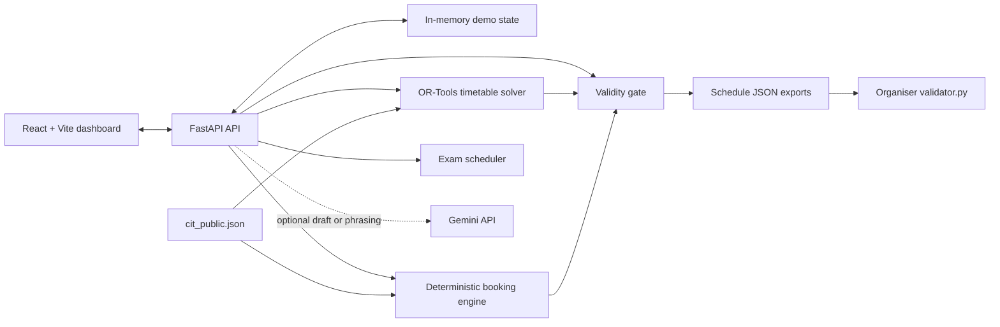

# InCIT

InCIT is a timetable and campus-room scheduling demo for the Zephyr Hackathon / CrunchWeek dataset. It creates a weekly timetable, checks room booking requests, schedules exams, and lets staff propose timetable changes for Admin approval.

The important safety rule is simple: AI can help turn words into a draft, but only InCIT's own code and the organiser validator decide whether a timetable, booking, or change is valid.

## What it does

- Builds a timetable from the 189-session public dataset with OR-Tools.
- Checks hard rules such as room capacity, faculty and group clashes, lunch, lab slots, accessibility, fixed slots, and availability.
- Scores Spectra bookings by the dataset's priority rules and explains every rejection or alternative.
- Lets Faculty and Department coordinators submit change proposals; an Admin must approve a proposal before it changes the timetable.
- Provides timetable views by room, faculty, group, and day, including a phone-friendly read-only view.
- Accepts English and Hinglish booking requests as editable drafts. A user reviews the room, time, and requirements before the app validates and reserves it. Gemini is optional and only fills drafts or phrases code-derived explanations.

## Architecture



## Tech stack

- Backend: Python, FastAPI, Pydantic, OR-Tools CP-SAT
- Frontend: React, TypeScript, Vite, Tailwind CSS
- Data: the organiser's `cit_public.json` dataset and JSON schedule exports
- Optional AI: Gemini API, with prompts kept in `prompts/`

## Run from a clean machine

### You need

- Python 3.11 or newer
- Node.js 20.19 or newer, or 22.12 or newer, with npm (required by Vite 8)
- The organiser StarterPack folder if you want to run the official validator

### 1. Get the code and install Python packages

```powershell
git clone https://github.com/overclocked4r2/InCIT.git
cd InCIT
python -m venv .venv
.\.venv\Scripts\Activate.ps1
python -m pip install -r requirements.txt
```
 
On macOS or Linux, activate the environment with:

```bash
source .venv/bin/activate
```

### 2. Install the frontend packages

```powershell
cd frontend
npm ci
cd ..
```

### 3. Run the app

Open two terminals in the repository. In the first terminal, start the API:

```powershell
.\.venv\Scripts\python.exe -m uvicorn app.main:app --port 8000 --reload
```

In the second terminal, start the frontend:

```powershell
cd frontend
npm run dev
```

Open the address Vite prints (normally `http://localhost:5173`). The API documentation is at `http://localhost:8000/docs`.

### 4. Optional Gemini setup

Copy `.env.example` to `.env`, then add a Gemini key only if you want AI draft parsing and explanation phrasing. Do not commit `.env` or a real key.

Without a key, manual forms, deterministic booking checks, timetable views, and code-derived explanations still work.

### 5. Run checks

```powershell
.\.venv\Scripts\python.exe -m pytest -q
cd frontend
npm run build
cd ..
```

## Demo accounts

These shared accounts are seeded for the public demo. They demonstrate role-based
permissions; they are not individual staff accounts and must not be used for a
real institution.

| Role | Username | Password | Main use |
| --- | --- | --- | --- |
| Admin | `admin@incit.demo` | `admin123` | Approve timetable proposals, reset demo data, and request institute events |
| Department coordinator | `coordinator@incit.demo` | `coord123` | Generate timetables, submit changes, and request department events |
| Faculty | `faculty@incit.demo` | `faculty123` | Read timetables, request class changes, and request guest lectures |
| Club representative | `club@incit.demo` | `club123` | Submit club venue requests |

## Public demo and Render deployment

The current public demo is [incit.onrender.com](https://incit.onrender.com).
The Render service builds the frontend and serves it with the FastAPI backend.
For a native Render service, use the repository root as the working directory
and configure:

```text
Build command: pip install -r requirements.txt && cd frontend && npm ci && npm run build
Start command: uvicorn app.main:app --host 0.0.0.0 --port $PORT
Health check path: /health
```

`GEMINI_API_KEY` is optional; add it through the host's environment settings if
AI-assisted draft parsing and explanation phrasing are needed. Never commit a
real key. This configuration deploys the demo; it does not add persistent
storage or production identity management.

## A quick demo path

1. Sign in as the Department coordinator and open **Solver & timetable**.
2. Filter by a room, faculty member, or student group to find a class.
3. Open **NL booking** to prepare a room booking or a faculty change request.
4. Sign in as Admin and open **Disruptions & approvals** to approve or reject a pending class-change proposal.

## Validate the exported schedules

Set `STARTER_PACK` to the path of the organiser's StarterPack folder, then run these commands from the InCIT repository. In PowerShell, for example:

```powershell
$env:STARTER_PACK = "C:\path\to\CrunchWeek_StarterPack"
python "$env:STARTER_PACK/validator.py" --data data/cit_public.json --schedule exports/schedule.json
python "$env:STARTER_PACK/validator.py" --data data/cit_public.json --schedule exports/schedule_after.json --disruption "$env:STARTER_PACK/examples/sample_disruption.json" --baseline exports/schedule.json
```

The committed baseline export was checked with 0 hard violations and a soft
penalty of 3. The committed disruption export was regenerated through the app
and checked with 0 hard violations and 13 sessions moved (7 time changes and 6
room-only changes).

## Known limitations

- This is a public demo: state is kept in memory and resets when the server restarts.
- Demo credentials are shared and intentionally simple; do not use them for a real deployment.
- Gemini is optional. It never makes a validity, priority, or approval decision, and the app falls back to deterministic/manual paths if it is down.
- The app is designed around the supplied public dataset, not an institution's production identity or database system. A production rollout needs persistent storage and individually managed accounts or institutional sign-in.

## AI use and safety

See [AI_USAGE.md](AI_USAGE.md) for the product's optional Gemini use, the AI tools used to build the project, and the rules that keep validity decisions in deterministic code.
